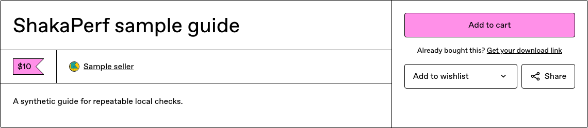
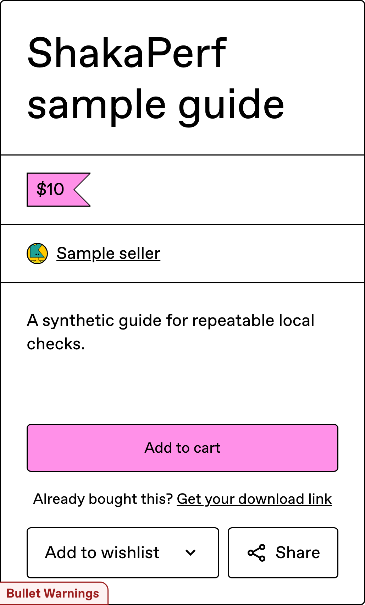

# Inertia landing calibration

The first completed campaign passed its configured comparison checks with **18 simultaneous pairs per viewport**. FCP and LCP differences were nonsignificant; their native paired 95% intervals span zero. This is a local A/A calibration, with no intended application optimization. It proves neither a speedup nor equivalence.

Control: complete upstream `921e1d56e1685084b66cb4a532439e4b3069de4c`. Experiment: the same application with optional integration, captured dirty on fork baseline `ad62684070c74caedef86aecc5d3d67c6526676e`. [Provenance](provenance.json) records hashes of the actual five executable/configuration inputs. After capture, the scenario received type annotations and scoped lint comments; its TypeScript emission with comments removed is byte-identical, with both source hashes and the emission proof recorded. Runtime behavior and comparison setup remain unchanged. Reproduce with `bin/shakaperf-local`; see [setup and interpretation](../../shakaperf.md).

ShakaPerf 0.3.1, shared 0.3.0, Lighthouse 13.4.1 and Playwright 1.58.2 are locked. Performance used installed Chrome Canary 157.0.8097.0; visual checks used Playwright Chromium 145.0.7632.6, revision1208. The Chrome executable hash is recorded, but the complete browser installation is not archived. Rails used development mode with prebuilt production Vite assets. Both sides used independent local data/services, cold browser cache, 200ms latency, 2700kbit/s throughput, 3x CPU slowdown, parallelism1, no retries, p=.05 and a 5% estimator regression threshold.

## Statistical evidence

Negative changes mean lower time/transfer on experiment. Native reports round their values; these are paired Hodges–Lehmann estimates, not differences between group medians. All rows have 18 finite samples per group. The statistical stage preserves simultaneous pairs and native paired Wilcoxon inference.

| Viewport / metric | Control → experiment median | Paired estimate | Native 95% interval | p |
| --- | --- | --- | --- | --- |
| Desktop FCP | 2090 → 2069ms | −16ms (−.79%) | [−35,7]ms; [−1.70,.33]% | .1297 |
| Desktop LCP | 12829 → 12830ms | −10ms (−.08%) | [−30,6]ms; [−.24,.05]% | .2462 |
| Desktop transfer | 3930.9 → 3930.9KiB | 0KiB | [−1.1,0]KiB | .4683 |
| Phone FCP | 2066 → 2062ms | −10ms (−.51%) | [−39,21]ms; [−1.89,.99]% | .5226 |
| Phone LCP | 12781 → 12766ms | −2ms (−.02%) | [−20,22]ms; [−.16,.17]% | .8986 |
| Phone transfer | 3922.3 → 3929.4KiB | 0KiB | [−13.9,.1]KiB | .3558 |

| Viewport / metric | Control descriptive range | Experiment descriptive range |
| --- | --- | --- |
| Desktop FCP | 2004.658–2276.515ms | 1986.963–2278.459ms |
| Desktop LCP | 12717.308–13187.223ms | 12690.082–13179.671ms |
| Desktop transfer | 3913.5684–3961.3262KiB | 3913.5859–3933.5098KiB |
| Phone FCP | 1998.187–2307.050ms | 2000.899–2305.935ms |
| Phone LCP | 12682.482–12913.475ms | 12662.570–12922.193ms |
| Phone transfer | 3913.6084–3958.1523KiB | 3913.5947–3958.0254KiB |

Read [desktop statistics](desktop-report.json), [phone statistics](phone-report.json), and all [desktop](desktop-ab-measurements.json)/[phone](phone-ab-measurements.json) samples. Raw time values encode microseconds under an `ms` label; divide by1000 for milliseconds. Transfer uses bytes/1024 despite a `KB` label. Empty raw sample metadata and zero `duration` fields supply no pairing identity: [native timing lines](pair-timing.json) retain sample indices0–17 and simultaneous navigation timestamps. The top-level compare report's empty metric summaries supply no estimates. Original statistical-artifact SHA256 values are in provenance.

## Seven-question review

| Question | Assessment and consequence |
| --- | --- |
| Limiter | Partly supported. Separate single-pair [diagnostics](diagnostics.json) show ~4.02MB transferred, ~0.98/1.02s main-thread work and a large vendor chunk. The upstream [chunk configuration](https://github.com/antiwork/gumroad/blob/921e1d56e1685084b66cb4a532439e4b3069de4c/config/vite/manual-chunks.ts) and request chain suggest cold asset transfer as a substantial cost. Shared host contention and load-generator saturation were not isolated; no causal bottleneck claim. |
| Production tuning | Missing production parity. Both local variants match, but development Rails, synthetic data, simulated throttling and a shared developer machine limit application/architecture conclusions. Host/Docker resources and before/after load are recorded. |
| Physical plausibility | Supported narrowly. ~4,024,509 bytes at2700kbit/s is nominally11.92s serialization, compatible with ~12.85s diagnostic LCP. Overlap, protocol overhead and resource contention prevent an additive attribution. No changed component or claimed saving exists in this calibration. |
| Errors | Local completion supported; global success incomplete. [Work counts](work-counts.json) record9400 attempted, successful and body-completed local requests across84 contexts, zero counted local HTTP/request failures and zero uncaught page errors. There are91 CSP console errors and one unattributed `ERR_CONNECTION_CLOSED` in phone control sample10. Live third-party failures are outside the local denominator. Native passing accessibility comparison still reports two existing critical rules on both sides. |
| Reproducibility | Supported source/tool/sample provenance with limits. All18 pairs, effective thresholds, commands, runtime/input hashes and machine load survive. Installed Chrome and live Stripe assets are not fully pinned. This permits workload reproduction, not identical timing across machines. |
| User relevance | Supported narrowly. Cold product landing content and checkout-link destination are checked at1280×800 and375×667. FCP/LCP describe initial paints, not full checkout, purchase success, steady-state traffic or production user latency. |
| Timed work | Paint boundary supported; full successful external work missing. Native timing logs place navigation, Lighthouse and awaited page checks in each paired collection. Assertions use the real Inertia product content and checkout URL; the product-view response clone must contain `success:true`. Image/font/DOM/network settling holds collection open. FCP/LCP remain navigation-relative paint times; post-paint assertions do not turn them into interaction durations. |

The diagnostic pair has119 network entries:112 local, one identically excluded Google request and six live Stripe requests. Diagnostic HTTP statuses were successful, but that single pair cannot certify every statistical sample. Stripe remains unexcluded and unpinned; it contributes ~0.29MB and a late request chain. Do not use diagnostic paint numbers or trace duration differences as effect estimates.

## Behavior and visual evidence

[Visual/accessibility evidence](behavior-visual-accessibility.json) records zero differing pixels, with no retry, for both article crops. Manual desktop/phone checks verified content and the local checkout-link destination; they did not make a purchase. Article crops omit the rest of the page. Existing accessibility findings on each side: critical `aria-roles` and `image-alt` (one node each), moderate `landmark-one-main` (one) and `region` (seven). A passing comparison does not mean an accessible page.

| Control | Experiment |
| --- | --- |
|  |  |
|  |  |

## Execution and limits

Launcher:2026-10-11T01:51:06Z–02:16:21Z (25m15s), including installation/build/setup and cleanup. Native compare metadata:1237288ms (20m37.288s), generated02:16:17.181Z. Desktop's18 pairs finished after9m54s of the shared performance stage; phone finished after19m09s measured from that same stage start, not an additional19m09s. The launcher’s1242.376228s comparison interval includes report/cleanup overhead. No favorable statistical rerun was made. Earlier setup attempts failed before completing any statistical pair and are retained separately.

The frozen optional tool lock has eight dependency advisories, including two critical classifications. This bounded local capture does not clear broader tool adoption; see the setup guide's source-reachability limits. Keep the workload optional, preserve failed work and raw artifacts, and separate guide/provenance automation from this integration. Existing ShakaPerf [#36](https://github.com/shakacode/shakaperf/issues/36), [#68](https://github.com/shakacode/shakaperf/issues/68) and [#69](https://github.com/shakacode/shakaperf/issues/69) cover those follow-ups. No new verification gate is added.
